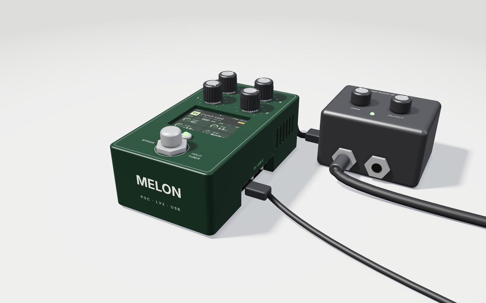

# Melon Pedal

A guitar multi-effects pedal built on a **Raspberry Pi** that runs LV2 plugins, in particular the [Melon Plugins](https://github.com/rmenes/melon_plugins). Effects are chained in a multi-FX rig and controlled from the pedal (knobs, footswitch, LCD), over MIDI, and from an Android app over Bluetooth.


## Three versions

Planned from the simplest to the most complete ([details](docs/product-versions.md)):


| | V1 · Proof of concept | V2 · HiFiBerry wedge | V3 · Floor unit |
|---|---|---|---|
| Status | **Running** (software tested on the Pi 4) | Design ready (fit-check print) | Concept |
| Size | 68 × 120 × 40 mm | 100 × 135 mm, 40 → 65 mm high | ≈ 240 × 170 mm, 45 → 70 mm |
| Audio | Any class-compliant USB interface (tested: Audient Sono, Momix) | HiFiBerry DAC2 ADC Pro + own I/O board: Hi-Z buffers, relay true bypass, MIDI | 6 in / 8 out board: guitar, AUX (combo XLR/TRS), FX loop, amp outs, **balanced XLR + TRS outs**, headphones |
| Screen | 2.0" ST7789 | 2.8" ILI9341 (320 × 240) | 5" 800 × 480 |
| Controls | 4 knobs + 1 footswitch | 4 knobs + 1 footswitch | 4 knobs + 4 footswitches, 2 expression inputs |
| Power | USB-C | 9 V pedal supply | 9 V supply **or battery** (4 × 18650) |
| Renders / CAD | [usb-audio](hardware/enclosure/usb-audio/README.md) | [hifiberry-wedge](hardware/enclosure/hifiberry-wedge/README.md) (printable STLs) | [v3-floor](hardware/enclosure/v3-floor/README.md) (renders only) |

| V1 | V3 |
|---|---|
|  |  |

## What works today (V1 on the Pi 4)

- **Multi-FX chain** of up to 10 LV2 blocks in series, in category order (gate → pitch → comp → drive → amp → cab → mod → delay → reverb → EQ), with a **DSP budget check** before a block is added ([DSP budget](docs/dsp-budget.md), [multi-FX design](docs/multifx-design.md)).
- **24 presets**; the pedal also remembers the **last sound** (chain, values, unsaved edits) and comes back to it after any restart.
- **Any class-compliant USB audio interface** is detected automatically (the one plugged in last wins; unplug/replug recovers on its own). **Audio I/O menu** on the pedal and in the app to choose the inputs (mono or stereo pairs) and outputs of multi-channel interfaces, remembered per interface.
- **LCD** user interface drawn by the `melon-display` service ([LCD design](docs/lcd-gui-design.md)).
- **Android app over Bluetooth LE**: chain editing, sound controls, presets, Wi-Fi setup (shows the pedal's IP and the `ssh` command), audio I/O.
- **MIDI** controller support (Livtra NexFoot today).
- Starts by itself at boot (systemd services: JACK → mod-host → controller, display, Bluetooth bridge).
- Melon Plugins built natively on the Pi, including **Melon MultiMod** (12 modulation machines).

## Repository layout

| Folder | Contents |
|---|---|
| `docs/` | Architecture, decisions, DSP budget, product versions, backlog, images |
| `hardware/bom/` | Shopping list / bill of materials |
| `hardware/enclosure/` | Enclosures and renders, one sub-folder per version (see each README) |
| `hardware/kicad/` | Circuit boards: I/O board and control board (coming next) |
| `software/system/` | Boot services, `melon-audio` (interface auto-detection), install script |
| `software/melon-pedald/` | The controller: chain, presets, knobs, MIDI, remote API |
| `software/melon-display/` | LCD service |
| `software/melon-ble/` | Bluetooth bridge for the app |
| `software/android-app/` | Android app (Kotlin, Jetpack Compose) |
| `software/plugins/` | Builds and installs the Melon Plugins on the Pi |
| `software/tools/` | DSP bench (`dsp_bench.py`) and cost estimates |

## Documentation

- [Product versions](docs/product-versions.md): V1 / V2 / V3 and the V3 decisions
- [Hardware architecture](docs/hardware-architecture.md) (v0.5): circuits, GPIO map, power budget, mechanical layout
- [Software architecture](docs/software-architecture.md): OS, JACK + mod-host, `melon-pedald`, LCD, app
- [Multi-FX design](docs/multifx-design.md) and [DSP budget](docs/dsp-budget.md): how many effects fit, measured on the Pi
- [USB audio interfaces](docs/usb-interfaces.md): requirements and the Zoom AMS-22 / AMS-24 comparison
- [System services](software/system/README.md): install, automatic audio interface, everyday commands
- [Decision log](docs/decisions.md) and [optimization backlog](docs/optimization-backlog.md) (includes the ideas to adopt from Ardor: seamless preset changes, lower latency, scenes…)
- [Shopping list](hardware/bom/shopping-list.csv)

## Status

- [x] Hardware architecture (v0.5: 2.8" screen, knobs at the back)
- [x] Software architecture, LCD design, Android app
- [x] USB boot on the Pi 4
- [x] V1: multi-FX chain, presets, LCD, MIDI, Bluetooth app running on the Pi
- [x] Automatic USB audio interface + audio I/O selection (tested with an Audient Sono)
- [x] DSP budget measured; Melon MultiMod estimated
- [x] V2 enclosure: wedge, tray + sloped lid (fit-check print, parametric)
- [ ] V2 breadboard prototypes (audio buffers, relays, MIDI, controls)
- [ ] KiCad schematics and PCBs
- [ ] ILI9341 driver for the 2.8" screen
- [ ] V2 enclosure final (after measuring the real parts)
- [ ] V3: audio board choice, back panel, enclosure

## Regenerating the CAD and renders

```
python3 hardware/enclosure/hifiberry-wedge/make_enclosure.py --preview   # V2 STLs + previews + clearance report
python3 hardware/enclosure/hifiberry-wedge/render_concept.py              # V2 renders (~1.5 min per view)
python3 hardware/enclosure/v3-floor/render_v3.py                          # V3 renders (~4 min per view)
```
Needs `numpy`, `scipy`, `matplotlib` and `Pillow`. The renders come from a small NumPy ray marcher (soft shadows, reflections, printed panel graphics, lit screen).
