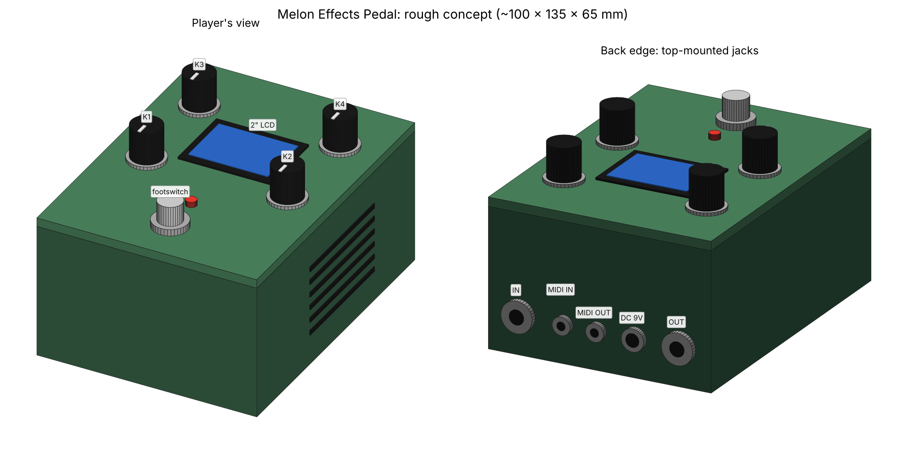

# Melon Pedal

A stereo guitar effects pedal built on a **Raspberry Pi 4** that runs LV2 plugins, in particular the [Melon Plugins](https://github.com/rmenes/melon_plugins).



## Features (planned)

- Raspberry Pi 4 Model B (8 GB) running Raspberry Pi OS (64-bit), booting from a USB 3 flash drive
- HiFiBerry DAC2 ADC Pro audio HAT (24-bit / up to 192 kHz)
- **Stereo in/out** on 6.35 mm TRS jacks: ~1.1 MΩ Hi-Z inputs, ~470 Ω low-Z outputs
- True bypass with relays (signal passes through when the pedal is off or booting)
- **MIDI IN** and **MIDI OUT/THRU** on 3.5 mm TRS jacks (Type A, same as Boss)
- 4 rotary encoders with push switches; parameters assigned in software
- 2.0" colour LCD (240×320, ST7789)
- Soft-touch footswitch
- Web interface over the Pi's Wi-Fi
- 9 V DC centre-negative power (1.5 A adapter)
- All jacks top-mounted for pedalboards
- 3D-printed enclosure, about 100 × 135 × 65 mm

## Repository layout

| Folder | Contents |
|---|---|
| `docs/` | Hardware architecture, optimization backlog, images |
| `hardware/bom/` | Shopping list / bill of materials |
| `hardware/kicad/` | Circuit boards: I/O board and control board (coming next) |
| `hardware/enclosure/` | 3D-printable enclosure (later) |
| `software/` | LV2 host setup, web UI, LCD/encoder/MIDI service (later) |
| `tools/` | Helper scripts, e.g. the concept render |

## Documentation

- [Hardware architecture](docs/hardware-architecture.md): circuits, GPIO map, power budget, mechanical layout
- [Optimization backlog](docs/optimization-backlog.md): ideas parked for after the first build
- [Shopping list](hardware/bom/shopping-list.csv)

## Status

- [x] Hardware architecture (v0.4)
- [x] Shopping list
- [ ] USB boot test on the Pi 4
- [ ] Breadboard prototypes (audio buffers, relays, MIDI, controls)
- [ ] KiCad schematics and PCBs
- [ ] Enclosure CAD
- [ ] Software

## Regenerating the concept render

```
python3 tools/render_pedal.py
```
Requires `matplotlib` and `numpy`. Output goes to `docs/images/`.
