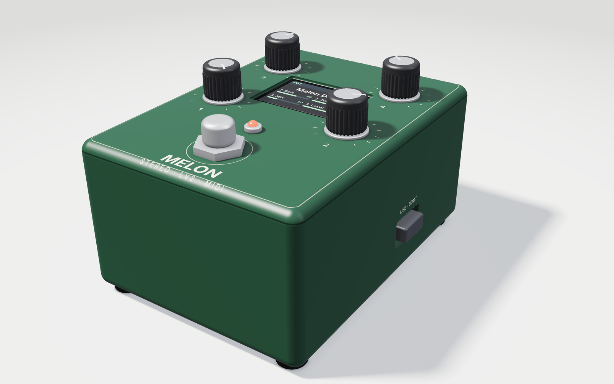

# Melon Effects Pedal — Hardware Architecture (v0.4)

Raspberry Pi 4 Model B (8 GB) running Raspberry Pi OS, hosting Melon Plugins (LV2).

**v0.4 changes (2026-11-17):** the Pi's micro-SD slot is broken → **boot + file system on a low-profile USB 3 flash drive (64 GB)** · USB ports now reached through a **required side-wall cut-out** · power budget updated.
**v0.3:** all connectors **top-mounted** (back edge) for pedalboard use: IN, OUT, MIDI IN, MIDI OUT, DC · new **I/O board** carrying all jacks + analog + MIDI + power · Pi rotated 90° · enclosure ~100 W × 135 L × 65 H mm.
**v0.2:** stereo TRS in/out · 3.5 mm TRS MIDI (Type A) · encoders · 9 V / 1.5 A supply checked.



---

## 1. Key decisions

| Area | Decision |
|---|---|
| Audio converter | **HiFiBerry DAC2 ADC Pro** HAT (PCM1863 ADC / PCM5122 DAC, stereo, 24-bit/192 kHz, ADC PGA −12…+32 dB) |
| Audio I/O | **Stereo IN / OUT** on 6.35 mm TRS (Tip = L, Ring = R, Sleeve = GND); mono TS cables work (§3.6) |
| Connector placement | **All jacks top-mounted** on the back edge, one row, on a single PCB (I/O board) |
| Hi-Z / Low-Z | On the I/O board: 2 × OPA2134 → 2 Hi-Z input buffers (~1.1 MΩ) + 2 low-Z output buffers (~470 Ω) |
| Bypass | 2 × DPDT signal relays (one per channel), unpowered = true bypass |
| MIDI | MIDI IN + MIDI OUT on 3.5 mm TRS **Type A** (Boss standard). Pi UART3, 31 250 baud. OUT = software OUT/THRU or hardware THRU (jumper) |
| Knobs | 4 × EC11 rotary encoders with push switch |
| Display | 2.0" SPI TFT 240×320 ST7789 |
| GPIO expander | MCP23017 (I2C) for encoder push switches + spares |
| Storage / boot | **64 GB low-profile USB 3 flash drive** (Samsung FIT Plus or SanDisk Ultra Fit) in a blue USB 3 port. The Pi 4's micro-SD slot is broken and unused |
| Power | 9 V DC centre-negative, 9 V / 1.5 A supply sufficient (worst case ≈ 1.1 A incl. USB drive) |
| Enclosure | 3D-printed, **~100 W × 135 L × 65 H mm**, aluminium bottom plate, side cut-out for USB |

---

## 2. Block diagram

```
   Back edge (top-mounted jacks) ─────────────────────────────────────────
   OUT TRS   DC 9V   MIDI OUT   MIDI IN   IN TRS
     │         │        │          │        │
┌────┴─────────┴────────┴──────────┴────────┴───────────────────────┐
│ I/O BOARD                                                          │
│  power protection + buck 5.1V │ MIDI OUT buf │ MIDI IN opto │ IN buffers │
│  OUT buffers + relays K1/K2   │   THRU jumper                           │
└───────────────┬──────────────────────────────┬────────────────────┘
                │ 5V, GPIO ribbon               │ shielded audio L/R in+out
┌───────────────▼──────────────────────────────▼────────────────────┐
│ Raspberry Pi 4 (rotated: 85 mm side across the width)              │
│  + HiFiBerry DAC2 ADC Pro (I2S/I2C)                                │
│  + USB 3 boot drive ──► through right side-wall cut-out            │
└───────────────┬────────────────────────────────────────────────────┘
                │ ribbon/flat cable
┌───────────────▼────────────────────────────────────────────────────┐
│ CONTROL BOARD (under lid): 4 encoders, MCP23017, 2" TFT, LED       │
└────────────────────────────────────────────────────────────────────┘
   Front: soft-touch footswitch (wired to GPIO 12)
```

---

## 3. Analog circuits (on the I/O board)

U1 = OPA2134 (input buffers L/R), U2 = OPA2134 (output buffers L/R). TL072 acceptable on a budget. Avoid NE5532.

### 3.1 Supply + reference
- 9V (after protection) → 100 Ω → **9V_A**, 220 µF + 100 nF to AGND.
- **Vref** = 9V_A via 10 k / 10 k, 47 µF + 100 nF (≈4 V).
- 100 nF at each op-amp V+ pin.

### 3.2 Input buffer — per channel
```
IN tip/ring ─[relay NO]──┬── 2.2MΩ ── AGND          (anti-pop)
                         └── 100nF film ──┬── 2.2MΩ ── Vref   (bias)
                                          ├── 100pF ── AGND   (RF)
                                          └── 1kΩ ──► U1A(+) ; out → (−)
U1A out ── 10µF ──┬── 100Ω ──► HiFiBerry ADC input (header)
                  └── 100kΩ ── AGND
```
Zin ≈ 1.1 MΩ.

### 3.3 Output buffer — per channel
```
HiFiBerry DAC out ── 4.7µF ── 10kΩ ──┬── 3.3kΩ ── Vref     (÷4, −12 dB)
                                     └──► U2A(+) ; out → (−)
U2A out ── 10µF ── 470Ω ──┬──► OUT tip/ring [relay NO]
                          └── 100kΩ ── AGND
```

### 3.4 Bypass relays
- 2 × Panasonic **TQ2-5V** (DPDT, non-latching). K1 = L, K2 = R. Unpowered ⇒ IN→OUT direct.
- Driver: GPIO 14 → 1 kΩ → BC337 (100 kΩ base pulldown); coils in parallel, 1N4148 flyback each; LED + 1.5 kΩ in parallel with coils.
- Software: 10–20 ms mute ramp before switching.

### 3.5 I/O-board layout & noise rules
- **Left end (OUT + DC side):** power protection, buck converter, output buffers. **Right end (IN side):** input buffers. Keeps the switching regulator as far as possible from the Hi-Z inputs.
- Star ground at the IN jack sleeve; solid ground pour; buck in its own corner with its own ground return.
- Shielded or twisted pairs to the HiFiBerry headers.
- Copper foil "can" over the input-buffer area only (not the whole box, for Wi-Fi/BT).
- **Centre-negative DC:** the barrel jack's outer sleeve is +9 V. Keep it away from grounded copper shielding.

### 3.6 Mono / stereo with TRS jacks
- Mono TS cable in IN → R shorted to ground → software *Auto/Mono/Stereo* input mode.
- Mono TS cable in OUT → R output shorted; the 470 Ω resistor protects the op-amp; software mutes R in mono mode.

---

## 4. MIDI (3.5 mm TRS, Type A)

Type A: **Tip = DIN pin 5**, **Ring = DIN pin 4**, **Sleeve = DIN pin 2 (shield)**. UART3 (`dtoverlay=uart3`): **GPIO4 = TX, GPIO5 = RX**.

### 4.1 MIDI OUT (3.3 V)
```
+3.3V ── 33Ω ──────────► Ring (pin 4)
TX (GPIO4) ─► 74LVC1G125 ── 10Ω ──► Tip (pin 5)
Sleeve ── GND
```
**J_THRU** jumper: buffer input = Pi TX (OUT/soft-THRU) or MIDI IN opto output (hardware THRU).

### 4.2 MIDI IN
```
Ring (pin 4) ── 220Ω ──► H11L1 LED anode
Tip  (pin 5) ───────────► H11L1 LED cathode
1N4148 reverse-parallel across LED; Sleeve not connected
H11L1 Vcc 3.3V (100nF), out ── 1kΩ pull-up ──► RX (GPIO5)
```

---

## 5. GPIO allocation (BCM)

Reserved: GPIO 0/1 (HAT EEPROM), 2/3 (I2C), 18–21 (I2S). **Verify against the HiFiBerry pinout.**

| Function | GPIO | Header pin |
|---|---|---|
| I2C SDA / SCL (HiFiBerry + MCP23017) | 2 / 3 | 3 / 5 |
| MIDI TX / RX (UART3) | 4 / 5 | 7 / 29 |
| LCD MOSI / SCLK / CS | 10 / 11 / 8 | 19 / 23 / 24 |
| LCD DC / RST | 25 / 24 | 22 / 18 |
| LCD backlight | 3V3 | 17 |
| Encoder 1 A / B | 6 / 13 | 31 / 33 |
| Encoder 2 A / B | 16 / 17 | 36 / 11 |
| Encoder 3 A / B | 22 / 23 | 15 / 16 |
| Encoder 4 A / B | 26 / 27 | 37 / 13 |
| Footswitch | 12 | 32 |
| Relays + LED driver | 14 | 8 |
| MCP23017 INT | 15 | 10 |
| Spare | 7 (`dtoverlay=spi0-1cs`) | 26 |
| 5 V in (from I/O board buck) | — | 2, 4 |
| GND | — | 6, 9, 14, 20, 25, 30, 34, 39 |

MCP23017 (0x20): GPA0–3 = encoder switches, rest spare. Encoder A/B: 10 kΩ pull-ups + 10 nF. Serial console disabled.

---

## 6. Controls & display
- Encoders: Alps EC11 / Bourns PEC11R, 20–24 detents, push, 6 mm D-shaft, on the control board under the lid.
- Footswitch: soft-touch momentary SPST (short = bypass, long = next preset).
- LED: 3 mm. Display: 2.0" ST7789 behind a lid window.

---

## 7. Power

### 7.1 Budget (worst case)
| Load | Power |
|---|---|
| Pi 4, 100 % CPU (~1.28 A @ 5 V) | 6.4 W |
| 2" TFT | 0.5 W |
| HiFiBerry | 0.3 W |
| 2 relays + LED | 0.3 W |
| MCP23017, MIDI, encoders | 0.1 W |
| USB 3 flash drive (while writing) | ≈ 1.0 W |
| 5 V rail | ≈ 8.6 W |
| Buck losses (~90 %) | ≈ 0.95 W |
| 9V_A analog | 0.1 W |
| **Total from 9 V** | **≈ 9.7 W → ≈ 1.1 A** |

9 V / 1.5 A is still OK (~35 % headroom), provided no other USB devices draw more than ~150 mA (a small USB-MIDI controller is fine) and the adapter is dedicated (not a shared pedalboard output).

### 7.2 Circuit (I/O board, left end)
- PCB-mount 2.1 mm barrel jack wired **centre = GND (−), sleeve = +9 V**.
- Reverse polarity: SS34 Schottky or AO3401 P-MOSFET; TVS SMBJ15A; 470 µF.
- Buck: Pololu D36V28F5 (5 V / 3.2 A) or MP1584/XL4015 set to 5.1 V → short ≥ 22 AWG wires to Pi GPIO pins 2 + 4.
- Storage safety (USB drive): overlay (read-only) filesystem + small writable preset partition, so pulling the plug can't corrupt the OS.

---

## 8. Mechanical layout

### 8.1 Back panel (top-mounted jacks), viewed from the player's position, one row
External width 100 mm; jack centres measured from the **left** edge:

```
 ┌──────────────────────────────────────────────────────────────┐
 │   (OUT)      (DC)     (MIDI OUT) (MIDI IN)       (IN)        │
 │  6.35 TRS    2.1mm     3.5 TRS    3.5 TRS      6.35 TRS      │
 └──────────────────────────────────────────────────────────────┘
     14 mm      34 mm      51 mm      66 mm        86 mm
```
- Gaps sized for **right-angle / pancake plugs** (pedalboard standard): 6.35 plug body ≤ 20 mm Ø, DC and 3.5 mm plug bodies ≤ 10 mm Ø.
- Jack centre height ≈ 15–18 mm above the enclosure floor (set by the I/O board standoffs) so plugs clear the pedalboard.
- Engrave labels above each jack on the print.

### 8.2 Top view (~100 W × 135 L mm)
```
                   back edge (jacks)
        ┌──────────────────────────────────┐
        │ [ I/O BOARD ~30 mm deep ]        │  ← jacks, buffers, relays, MIDI, buck
        │----------------------------------│
        │   (K1)                  (K2)     ├─ USB cut-out (right side wall):
        │          ┌──────────┐            │  Pi USB ports + boot drive
        │          │  2" LCD  │            │
        │   (K3)   └──────────┘   (K4)     │
        │----------------------------------│
        │              (LED)               │
        │         [ FOOTSWITCH ]           │  ← front zone ~35 mm
        └──────────────────────────────────┘
                      front
```

### 8.3 Internal arrangement
- **Back zone (~30 mm):** I/O board on standoffs, horizontal, jacks protruding through the back wall.
- **Middle zone (~60 mm):** Pi 4 rotated so its 85 mm side runs across the width, **GPIO header facing the back** (short wiring to the I/O board). The USB/Ethernet end faces the right side wall, which has a **required cut-out** for the USB ports. The Pi's port face sits ~1 mm inside the wall, so the USB boot drive is reachable from outside (re-flash or back up without opening the pedal) and sticks out only a few mm. Keep the drive in a recessed pocket so it isn't knocked on a pedalboard. The drive cannot go fully inside: Pi + ports + drive is wider than the ~94 mm internal width. No micro-SD access needed (slot is broken). HiFiBerry on its 12 mm spacers. **Check HiFiBerry RCA/3.5 mm connector clearance against the side wall.**
- **Front zone (~35 mm):** footswitch (body ~25 mm deep) kept clear of the Pi stack.
- **Lid:** control board (encoders, MCP23017, LCD, LED), flat cable to the Pi header area.
- **Height check:** Pi + HAT stack ≈ 40 mm from floor; control board + encoders hang ≈ 15 mm below lid; internal height ≈ 60 mm → OK.
- Aluminium bottom plate, low-profile Pi heatsink, side/bottom vents, provision for a 30 mm fan.

---

## 9. Bill of materials (v0.4)

Full shopping list with AliExpress search terms and spares: [hardware/bom/shopping-list.csv](../hardware/bom/shopping-list.csv). The prototype uses through-hole substitutes (1N5822, P6KE15A, 74HC125, Mini560 module) for some SMD/PCB parts below.

| Qty | Part | Notes |
|---|---|---|
| 1 | Raspberry Pi 4 B 8 GB | micro-SD slot broken |
| 1 | 64 GB low-profile USB 3 flash drive (Samsung FIT Plus / SanDisk Ultra Fit) | boot + file system; buy from an official store |
| 1 | HiFiBerry DAC2 ADC Pro | |
| 1 | 2.0" ST7789 SPI TFT 240×320 | |
| 4 | EC11 encoders with switch + knobs | |
| 1 | MCP23017 | |
| 1 | Soft-touch momentary footswitch | |
| 2 | Panasonic TQ2-5V | |
| 1 | BC337, 3 × 1N4148 | |
| 2 | OPA2134 (or TL072) | |
| 2 | **PCB-mount 6.35 mm stereo (TRS) jacks** with threaded bushing | e.g. Neutrik NMJ6HCD2 or Lumberg/Cliff PCB type |
| 2 | **PCB-mount 3.5 mm stereo jacks** with threaded bushing | e.g. Lumberg 1503 09 / CUI SJ1-355x panel-nut type |
| 1 | **PCB-mount 2.1 mm DC jack** with nut | wired centre-negative |
| 1 | H11L1, 74LVC1G125, 3-pin header + jumper | MIDI |
| 1 | Pololu D36V28F5 or MP1584 buck | |
| 1 | SS34 or AO3401, SMBJ15A | |
| — | Resistors: 2.2M ×4, 100k ×5, 10k ×10, 3.3k ×2, 1.5k, 1k ×4, 470 ×2, 220, 100 ×3, 33, 10 | |
| — | Caps: 100n film ×2, 4.7µ ×2, 10µ ×4, 47µ, 220µ, 470µ, 100n ceramic ×8, 100p ×2, 10n ×8 | |
| — | Heatsink, M2.5/M3 standoffs, 40-pin flat cable / IDC, shielded wire, copper tape, aluminium plate | |
| — | 9 V / 1.5 A centre-negative adapter; Type A TRS-MIDI cables; right-angle/pancake 6.35 TRS cables | |

---

## 10. Build plan
0. **USB boot test first:** flash Raspberry Pi OS (64-bit) to the USB drive with Raspberry Pi Imager, plug it into a blue USB 3 port, power on with no SD card. Newer Pi 4 bootloaders try USB after SD by default (BOOT_ORDER 0xf41). If it doesn't boot, the bootloader EEPROM is too old and must be updated once; that is normally done from an SD card, so it needs a workaround.
1. Bench test Pi + HiFiBerry.
2. Stereo buffers + relays on breadboard; noise test with buck running.
3. MIDI IN/OUT + UART3 loopback.
4. LCD, encoders, MCP23017, footswitch test scripts.
5. 9 V / 1.5 A full-load test.
6. **KiCad: I/O board** (jacks + analog + MIDI + power, top-mount jack row) and **control board** (lid). Jack positions from §8.1 drive the PCB outline.
7. Parametric enclosure CAD from the PCB outlines + measured parts.
8. Software phase.
