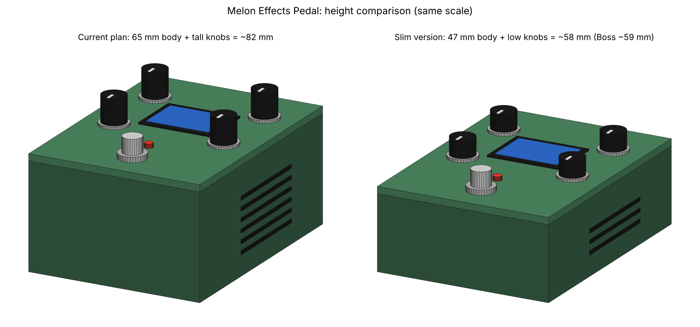

# Melon Effects Pedal — Optimization backlog

Decision (2026-11-17): build the **v0.3 design as-is first** (~100 × 135 × 65 mm body, ~82 mm total height with knobs, HiFiBerry jacks kept). Optimize after the first build reveals the real challenges.

## Ideas parked for later

### Height reduction to Boss height (~58 mm total)
| Change | Saves |
|---|---|
| Desolder unused RCA + 3.5 mm jacks from the HiFiBerry DAC2 ADC Pro (audio is wired via headers) | ~8–10 mm |
| Low-profile knobs (~10 mm instead of ~15 mm) | ~5 mm |
| Tighten clearance between Pi/HAT stack and lid control board | ~8–10 mm |
| **Result** | 47 mm body + 10 mm knobs ≈ 58 mm |

Stack budget for the slim version: floor + standoffs + Pi PCB ~7 mm · HAT on 12 mm spacers ~20 mm · clearance ~3 mm · control board ~12 mm · lid ~3 mm.
Watch-out: less internal air, so verify Pi temperature under full plugin load (vents + optional 30 mm fan).

### Even lower: 40 mm body (checked 2026-11-17, not planned)
Possible only on paper, with ~1–2 mm margin: 2 mm aluminium plate, 3 mm Pi standoffs, HiFiBerry RCA + 3.5 mm jacks desoldered, a flat control board (~10.5 mm below the top). The LCD and knobs 1/3 sit over the HAT, knob 2 ~4 mm above the Pi USB stack. No room for the 30 mm fan; cooling relies on the aluminium plate. Comfortable 40 mm needs a lower stack (CM4/CM5 carrier or a combined custom HAT).
Enclosure: change `H_TOTAL`, `PLATE_T`, `PI_STANDOFF` in `hardware/enclosure/hifiberry-wedge/make_enclosure.py` (v0.2 wedge: `H_FRONT`, `H_BACK`, `PI_STANDOFF`) and check the cross-sections.

### Other possible later optimizations
- Width: a smaller compute board (CM4/CM5 or Pi Zero 2 W) could reach true Boss width (~73 mm).
- Combined custom HAT (codec + front-end + MIDI) to remove the HiFiBerry entirely.

### Automatic USB audio interface support (added 2026-11-23)
Goal: the pedal recognizes and uses any **class-compliant** USB audio interface automatically, with a manual override menu on the pedal LCD and in the Android app. Fits the current services (`melon-jack` → `melon-modhost` → `melon-pedald`); no architecture change.

**Automatic detection**
1. A udev rule notifies `melon-pedald` when a USB audio device is plugged in or removed. Cards are identified by ALSA name (e.g. `hw:CARD=AMS22`), not by card number, which changes between boots.
2. The daemon reads each card's input/output channel counts and supported sample rates from ALSA.
3. JACK can't switch devices while running, so the daemon restarts `melon-jack` → `melon-modhost`, then reloads the current plugin and preset. Expect a few seconds of dropout; the output is muted during the switch (no relays on the USB build).
4. Device priority: a newly plugged USB interface wins; with none, fall back to the HiFiBerry if present. If the active interface is unplugged, fall back the same way instead of leaving JACK dead.
5. Default routing: input 1 → plugin (mono), or inputs 1 + 2 in stereo mode; plugin → outputs 1 + 2.
6. Per-interface settings (ports, buffer size, periods) are saved in `/data`, keyed by USB vendor/product ID, and restored on reconnect. Needed because interfaces differ (Momix needed 256 × 3; HiFiBerry target 128 × 2).

**Manual menu (pedal LCD + Android app over BLE)**
- Settings → Audio: device, input channel(s), output pair, mono/stereo, buffer size.

**Known limits (to state in the user documentation)**
- Interface hardware switches can't be controlled by software (e.g. Zoom AMS DIRECT MONITOR, LOOPBACK, MUSIC/STREAMING, Hi-Z). The user must set them: direct monitor off, loopback off. Possible extra: warn when the dry input appears to leak into the output.
- Interfaces that need a vendor driver (not class-compliant) are not supported.

### Ideas from Ardor (added 2026-11-24, decided to do later)
[Ardor](https://github.com/balazsbencs/ardor) (MIT; its FFTW part is GPL) is another Raspberry Pi 4 guitar processor: one C++20 program with built-in effects, LVGL touchscreen, Go/React web manager, Buildroot image. Compared with our plugin-host design (JACK + mod-host + LV2 + Python controller) on 2026-11-24. Decision: keep our architecture and **adopt these five features later**.

1. **Seamless preset changes.** Ardor builds the new engine off the audio thread and swaps it in with a short crossfade. For us: build the new chain beside the old one in spare mod-host instances, then switch the JACK links with a ~10 ms fade, then remove the old blocks. Today a preset with different plugins rebuilds the chain and leaves a short gap (same plugins = values only, already gap-free).
2. **Lower latency.** Ardor runs 64-frame blocks with full NAM on a Pi 4 (their bench: 64 passes, 32 fails). We run 256 × 3. Measure 128 (and 64) with the bench, per interface (`audio.d/<card>.conf`); see `dsp-budget.md` §7.
3. **Callback timing stats.** Ardor counts over-budget callbacks, gaps and the worst callback time. Add the same to the DSP meter (LCD header, app): worst period time and late callbacks, next to the xrun count.
4. **Scenes.** Four named parameter snapshots inside a preset (values, block on/off, a level trim), recalled from the footswitches without rebuilding the chain, switched instantly or over 0.1–10 s. Delay/reverb can "let ring" when bypassed.
5. **Buildroot / read-only root.** A reproducible firmware image with a read-only root and a writable data partition, so pulling the plug can't corrupt the system (our software architecture already plans a read-only root + `/data`).

Not planned: Ardor's compiled-in effects and cloud service (we keep LV2 plugins and the Bluetooth app).

### Ideas from the TONE3000 DIY pedal (added 2026-11-24, decided to do later)
[t3k-diy-pedal](https://github.com/tone-3000/t3k-diy-pedal) (MIT) runs NAM A2-Lite captures on an Electrosmith Daisy Seed (no Linux, four presets of one or two blocks, web app over USB). Its firmware doesn't apply to the Pi, but its gain staging and TONE3000 integration do. Decision: **adopt these seven later**, and **keep both NAM sizes (Full and Light)**: they ship A2-Lite only; we keep Melon NAM's Model Size choice.

1. **NAM input calibration.** Captures with calibration data store `input_level_dbu` (dBu at the gear for 0 dBFS). Feed each capture `pedal_input_dbu − input_level_dbu` dB, so it reacts like the real gear. Melon NAM gets an input-calibration parameter; the pedal sets it from a per-interface figure (`INPUT_DBU` in `audio.d/<card>.conf`; their pedal is +2.2 dBu). Captures without the data stay at unity; the input knob still trims on top.
2. **Calibrated hand-off between two captures.** When a capture feeds another one (drive capture into amp capture) and carries `output_level_dbu`, scale its output by `output_level_dbu − pedal_input_dbu` dB instead of normalizing, so the second capture is pushed as hard as the real pedal pushed the real amp. Needs the controller to know which NAM block feeds which.
3. **Loudness normalization with a ±12 dB clamp.** The last capture is brought to −18 dB loudness, never adjusted by more than ±12 dB (unity without data). Melon NAM already normalizes (NeuralAudio's recommended level); add the clamp.
4. **Cab IR at unity in-band gain.** Scale the IR so its mean power response over 100 Hz–5 kHz (log-spaced) is 0 dB, so amp-only and amp + cab presets sit at the same level. Melon Cab uses JUCE's energy normalization today. Folded into the IR at load.
5. **Clip indicator.** Flag input or output peaks ≥ 0.98 of full scale: LED flash, LCD header and app.
6. **TONE3000 in the app.** TONE3000 sign-in (OAuth PKCE), browse tones, download `.nam` / IR files straight into the pedal's library (`/data/media/NAM`, `/data/media/IR`). Store each file's TONE3000 model id in the preset so a missing file can be fetched again. Needs a TONE3000 API key.
7. **Release builds on GitHub Actions.** Build the arm64 Melon Plugins release zip on every tag (the Pi installs it with `install-melon-plugins.sh --zip`, no compiling on the Pi) and an APK for the Android app.

Confirmed by their design: NAM Light (A2-Lite, ≈ 9 % CPU on our Pi 4) is good enough to ship as a product; our 9 V op-amp rail avoids the input clipping their single 5 V TL072 buffer has (≈ −1 dBu).
