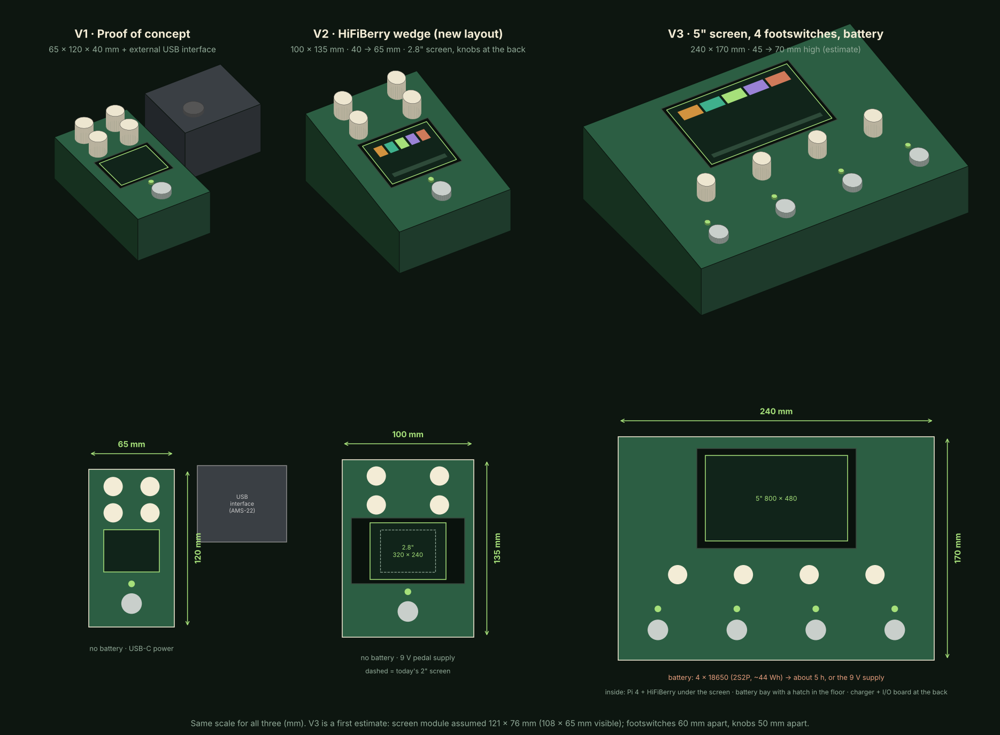

# Melon Pedal — product versions (plan, 2026-11-24)

Three versions are planned, from the simplest to the most complete. Only V1 and V2 exist as designs today; V3 is a first sketch.

| | V1 · Proof of concept | V2 · HiFiBerry wedge | V3 · Floor unit |
|---|---|---|---|
| Size | 65 × 120 × 40 mm | 100 × 135 mm, 40 → 65 mm high | ≈ 240 × 170 mm, 45 → 70 mm (estimate) |
| Audio | External USB interface (iOne, Zoom AMS-22/24, Audient Sono…) | HiFiBerry DAC2 ADC Pro + I/O board (buffers, relays, MIDI) | 6 in / 8 out multichannel board (option B), two balanced outputs |
| Screen | 2.0" ST7789 | **2.8" ILI9341 320×240** (v0.5) | **5" touch** (Raspberry Pi Touch Display 2, 1280×720) |
| Controls | 4 encoders (2 × 2 at the back), 1 footswitch | 4 encoders (2 × 2 at the back), 1 footswitch | 4 encoders, 4 footswitches, **output section: Volume + Bass / Mid / Treble** |
| Power | USB-C | 9 V pedal supply | 9 V supply **or battery** |
| Pi | Pi 4 | Pi 4 | **Pi 5** (multichannel board, 5" screen) |
| Docs | `04-poc-usb-interface.md`, `hardware/enclosure/usb-audio/` | `hardware-architecture.md`, `hardware/enclosure/hifiberry-wedge/` | this page |

## V3 decisions so far

**Audio board: option B, 6 in / 8 out.** Candidates (check availability before committing):
- **ezsound-6x8** (TI PCM3168, 6 in / 8 out, 96 kHz, isolated from the Pi; driver in Raspberry Pi OS). Raspberry Pi 5; was at the tester stage in late 2026. Best fit so far.
- **Audio Injector Octo** (Cirrus CS42448, 6 in / 8 out, TDM over the Pi's I2S). Older Kickstarter product; availability uncertain. The CS42448 chip itself has had sourcing problems.

**Channel plan (uses all 8 outputs):**

| | Inputs (6) | Outputs (8) |
|---|---|---|
| Main | Guitar (Hi-Z buffer) | Amp L / R (6.35 mm) |
| PA | | **Balanced L / R: male XLR + balanced 6.35 mm TRS per channel, same driver** |
| FX loop | Return L / R | Send L / R |
| Extra | AUX in L / R on **XLR/TRS combo jacks** (mic, line or a second instrument) | Headphones L / R |

- Balanced outputs: line driver per channel on the I/O board (DRV134 / THAT1646, or an op-amp differential stage), ground-lift switch. Combo jacks are always female XLR, so they go on the AUX inputs, not on the outputs (proposal 2026-11-24, to confirm).
- Not audio: 2 × expression pedal (I2C ADC), MIDI in/out, 9 V DC, USB-C for charging, optional USB-A for an external interface (the software already supports any class-compliant interface).
- **Back panel:** about 14 connectors do not fit in one row on 240 mm: two rows (the back is ~70 mm tall), some on a side panel, or a slightly wider box.

**Top layout (2026-11-25):** the screen sits on the left, the output section on the right. The four encoders are in a row under the screen; the first and last stay inside the screen's width (centres 62.5 mm from the screen centre, washers inside the 111.5 mm viewing area). The output section has **BASS, MID, TREBLE in a horizontal row** with a **bigger VOLUME** knob under it; the logo moved to the front right, next to the encoders. All knobs are **stepped** (wide skirt with the scale pointer, narrower knurled cap on top): ~15 mm skirt / ~10 mm cap, VOLUME ~20 mm / ~12.5 mm. They need 6 mm shafts (D or knurled) to fit the encoders and pots.

**Output section (2026-11-25):** four pots right of the screen: **VOLUME** and a three-band output EQ (**BASS, MID, TREBLE**). They are a master section like on an amp: they act on the whole pedal, after the effect chain, and do not change with presets.
- **Pots, not encoders:** the knob position is always what you hear, also after a preset change or a reboot. 10 kΩ linear; the EQ pots with a centre detent (flat). Pi 5 has no analog inputs, so they are read by a **second ADS1115** (I2C 0x49; the first one at 0x48 reads EXP 1/2). That leaves 2 spare channels.
- **Done in DSP, not with an analog tone stack:** there are 8 outputs, and one analog EQ + volume per output pair would mean lots of parts, noise and dual-gang pots. A small output stage after the chain does it: low shelf ~100 Hz, peaking mid ~800 Hz (Q 0.7), high shelf ~3.2 kHz, each ±12 dB, then volume (−∞ … +6 dB, audio taper in software). Smoothed to avoid zipper noise. Cost on the Pi 5: well under 1 % (3 biquads × 2 channels). Plan: a new "Melon Output" LV2 plugin in melon_plugins that melon-pedald always puts at the end of the chain; it is not shown as a normal block.
- **Which outputs:** by default Amp L/R, Balanced (XLR + TRS) and Phones. Not the FX send (the loop must stay at unity) and not the tuner. A setting in the app per output: follows the master section / fixed.
- **Screen and app:** they show the four values (read-only; the knob wins). Phones might get its own level later.

**Touch screen (2026-11-25):** the **Raspberry Pi Touch Display 2, 5"** (official, DSI, capacitive 5-point touch, 720 × 1280 used in landscape, US$40, made until at least January 2030). Outline 143.5 × 91.5 × 16 mm, viewing area 111.5 × 63 mm. Power from the GPIO header, ribbon to the Pi 5's DSI port.
- **Mounting:** the module sits under the lid; the window is the viewing area with a 1 mm chamfered recess, glass ~1.6 mm below the surface so a finger reaches the edges. It is at the back, away from the footswitches; the glass can break, so no boots on it. A 0.5 mm polycarbonate film over the window still works with capacitive touch.
- **Use:** touch for browsing (tap a block, swipe presets, drag a value); the four encoders stay for precise edits and the footswitches for playing. Everything still works with touch disabled.
- **Software:** melon-display today draws frames with Pillow and pushes them over SPI. For DSI it draws the same frames at 1280 × 720 to the screen through KMS/DRM (or SDL/pygame on KMSDRM), and reads touch with evdev (the touch controller shows up as a Linux input device). Hit areas map to the same actions as the encoders and the app (`melon_pedald` remote ops).

**Battery:** 4 × 18650 (2S2P, ≈ 44 Wh, ≈ 5 h), in a bay with a hatch in the floor, away from the Pi's heat, with a proper 2S charger/protection module (USB-C) and a temperature sensor. A battery monitor on I2C shows % on the screen and app and shuts down cleanly when low. See [battery options](images/battery-options.png) for why a battery doesn't fit V2 without a bigger box.

Concept renders: [`hardware/enclosure/v3-floor`](../hardware/enclosure/v3-floor/README.md).

**Next:** confirm the audio board and the back-panel layout, buy the Touch Display 2 to check the active area against its outline (the render assumes it is centred), then a first enclosure generator like V2's.
