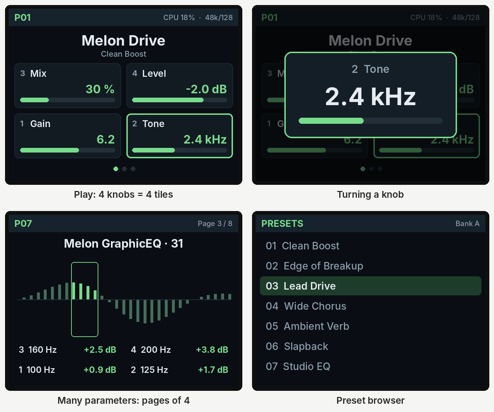

# Melon Pedal — Software Architecture (v0.2)

**v0.2 (2026-11-17):** controller in Python confirmed · Melon Plugins stay on **JUCE**; added the JUCE-on-ARM plan (§7) and support for LV2 *parameters* (JUCE style) next to control ports.

Goal for the first version: **one LV2 plugin loaded at a time**, controlled from the pedal (4 encoders, footswitch, 2" LCD), from MIDI, and from a web page over Wi-Fi. Runs on **Raspberry Pi OS Lite (64-bit)** on the Raspberry Pi 4.



---

## 1. Key decisions

| Area | Decision | Why |
|---|---|---|
| OS | **Raspberry Pi OS Lite, 64-bit** (Debian 13 "Trixie", kernel 6.18), no desktop, booting from the USB drive | Smallest official image; nothing competes with audio |
| Audio server | **JACK2** (`jackd`) on the HiFiBerry ALSA device, 48 kHz, 128 frames × 2 periods | Deterministic low latency; well supported by LV2 hosts |
| LV2 host | **mod-host** (from MOD Audio, GPL-3), headless, controlled over a TCP socket | Proven on Raspberry Pi pedals (MODEP, pi-Stomp); loads, connects and controls plugins by text commands |
| Pedal logic | **`melon-pedald`**, our own Python 3 (asyncio) daemon | Owns the "one plugin" rule, presets, LCD, encoders, footswitch, relays, MIDI and the web UI |
| Plugin GUI on the LCD | **Generated from the plugin's LV2 metadata** (port names, ranges, units, enums), with optional per-plugin "pedal profiles" | Works with any LV2 plugin; no custom GUI code per plugin. The plugins' own desktop GUIs are not used |
| Web UI | Served by `melon-pedald` (HTTP + WebSocket) at `http://melon.local` | Phone/laptop editing over Wi-Fi |
| Wi-Fi | Joins a known network; falls back to its own hotspot **"Melon-Pedal"** | Always reachable, at home or on stage |
| Storage | Read-only root filesystem + writable **`/data`** partition (presets, plugins, settings) | Pulling the plug can't corrupt the OS |

**Not chosen (for v1):**
- *PiPedal* and *MODEP/mod-ui*: complete pedalboard apps with their own UI and multi-plugin chains. More than we need, and harder to bend to our LCD and knob layout.
- *Our own C++ host (lilv + JACK)*: maximum control, but more work. `melon-pedald` talks to the engine through a small interface (§4.1), so mod-host can be swapped for our own host later without touching the UI, presets or web code.
- *PipeWire*: fine for desktops, but JACK gives more predictable latency on a dedicated device. PipeWire/PulseAudio must not hold the audio card.

---

## 2. Block diagram

```
                 ┌────────────── Raspberry Pi OS Lite (64-bit) ──────────────┐
                 │                                                            │
  Phone/laptop ──┼─► Wi-Fi ─► melon-pedald ──── web UI (HTTP + WebSocket)     │
                 │              │  ▲                                          │
   4 encoders ───┼─► evdev ─────┤  │  event bus (single source of truth)     │
   enc. switches ┼─► MCP23017 ──┤  │                                          │
   footswitch ───┼─► GPIO ──────┤  │                                          │
   MIDI IN ──────┼─► UART3 ─────┤  │                                          │
   MIDI OUT ◄────┼── UART3 ◄────┤  │                                          │
   LCD ◄─────────┼── SPI ◄──────┤  │                                          │
   bypass relays ┼── GPIO ◄─────┤  │                                          │
                 │              │  │ TCP :5555 commands / :5556 feedback      │
                 │              ▼  │                                          │
                 │           mod-host ── 1 LV2 plugin (instance 0)            │
                 │              │                                             │
                 │            JACK2 (48 kHz, 128 × 2)                          │
                 │              │                                             │
                 │      ALSA: HiFiBerry DAC2 ADC Pro (I2S)                    │
                 └────────────────────────────────────────────────────────────┘
```

Three `systemd` services start in order: `jackd` → `mod-host` → `melon-pedald`. The bypass relays stay in true bypass until `melon-pedald` reports "ready", so the pedal passes the dry signal while it boots.

---

## 3. Audio engine

### 3.1 JACK settings (starting point)
- Device `hw:sndrpihifiberry`, 48 kHz, **128 frames, 2 periods** → ~5.3 ms of buffering, plus converter delay. Try 64 frames once everything works; go to 256 if there are xruns.
- Real-time scheduling: user in the `audio` group, `rtprio 95`, `memlock unlimited`.
- CPU governor `performance`; audio threads pinned to cores 2–3, UI and web on cores 0–1.
- Wi-Fi power saving off (avoids latency spikes).

### 3.2 One-plugin rule
`melon-pedald` only ever uses mod-host **instance 0**. Loading another plugin replaces it.

### 3.3 Glitch-free plugin swap
1. Ramp the output down (~10 ms) and switch the **relays to bypass**: the player hears the dry guitar, not silence.
2. `remove 0`
3. `add <plugin-uri> 0`
4. Connect JACK ports for the plugin's channel layout (§3.4).
5. Apply the preset's parameter values (`param_set 0 <symbol> <value>`).
6. Wait ~50 ms, then switch the relays back to the effect.

Expected swap time: 0.2–1 s, depending on the plugin.

### 3.4 Mono / stereo routing
| Plugin ports | Input mode Mono (TS cable) | Input mode Stereo (TRS) |
|---|---|---|
| 1 in / 1 out | IN L → plugin → OUT L + OUT R | IN L → plugin → OUT L + R (IN R unused) |
| 1 in / 2 out | IN L → plugin → OUT L / R | IN L → plugin → OUT L / R |
| 2 in / 2 out | IN L → both plugin inputs → OUT L / R | IN L/R → plugin → OUT L / R |

Input mode *Auto* treats IN R as absent when it is silent (a mono plug grounds the ring).

### 3.5 CPU budget
The Pi 4 has four cores. One plugin at 48 kHz / 128 frames leaves plenty of headroom for typical effects. The JACK DSP load and xrun count appear on the LCD header and the web UI, which tells us early if a heavy plugin (e.g. amp modelling) needs a bigger buffer. Several plugins in a chain can come later.

---

## 4. `melon-pedald` (the pedal controller)

Python 3.13 (Trixie's version), `asyncio`, one process. Modules:

| Module | Job | Libraries |
|---|---|---|
| `engine` | mod-host client: load/remove plugin, set params (`param_set` for control ports, `patch_set` for LV2 parameters), bypass, JACK connections, read feedback (meters/outputs) | `asyncio` sockets |
| `catalog` | Scan installed LV2 bundles and read both kinds of controls: **control ports** and **LV2 parameters** (`lv2:Parameter` / `patch:writable`, which JUCE uses), with symbol/URI, name, min/max/default, unit, toggled, integer, enumeration, logarithmic → JSON cache | `python3-lilv` |
| `profiles` | Optional per-plugin "pedal profile": which parameters go on which page/knob, short labels, display style. Without one, profiles are generated automatically (4 params per page, in port order) | JSON files |
| `presets` | Preset = plugin URI + parameter values + profile + name. Banks of presets. Program Change → preset | JSON in `/data/presets` |
| `controls` | Encoders (kernel `rotary-encoder` overlay → evdev, with acceleration), encoder switches (MCP23017 on I2C, INT pin), footswitch (short/long press), relays + LED | `python-evdev`, `smbus2`, `gpiod` |
| `display` | Draws screens with Pillow at 320 × 240 and pushes them over SPI to the ST7789; redraws only on change, max ~30 fps | `Pillow`, `spidev` |
| `midi` | UART3 at 31 250 baud: CC → parameter (with MIDI learn), PC → preset, clock → tempo; software THRU | `pyserial` |
| `web` | REST + WebSocket API and the static web app; bundle upload | `aiohttp` (or FastAPI) |
| `system` | Wi-Fi/hotspot status, IP, CPU temp and load, reboot, read-only-FS switch for updates | NetworkManager (`nmcli`) |

All modules talk through one **event bus** holding the current state (plugin, parameter values, bypass, page). Turning a knob, a MIDI CC and a web slider all produce the same `param_changed` event, so the LCD, web page and engine always agree.

### 4.1 Engine interface (lets us replace mod-host later)
```
load_plugin(uri, channel_layout) -> PluginInfo
unload()
set_param(symbol, value)
set_bypass(on)
get_load() -> {dsp_load, xruns}
on_feedback(callback)          # output ports: meters, tuner, etc.
```

### 4.2 Parameter mapping
- Each knob moves its parameter in steps that fit the range: about 100 steps over the full range for continuous controls (faster when turned quickly), one step per detent for integers and enums, and push to flip toggles.
- Logarithmic parameters (e.g. frequency) move in log steps.
- Values are always shown with the plugin's unit (dB, Hz, ms, %).

---

## 5. Pedal user interface

### 5.1 Screens (320 × 240)
- **Play** (default): preset number and name, plugin name, **four parameter tiles laid out like the physical knobs** (3 and 4 on top, 1 and 2 below), page dots. Header shows CPU load and buffer size, and a red **BYPASS** badge when bypassed.
- **Value pop-up**: turning a knob shows its parameter large for ~1 s.
- **Pages**: plugins with more than four parameters get pages of four. Example: Melon GraphicEQ with 31 bands → 8 pages; the graph highlights the 4 bands on the knobs.
- **Preset browser**, **plugin browser**, **settings** (input mode, MIDI channel, Wi-Fi info, buffer size).

### 5.2 Controls
| Control | Action |
|---|---|
| Knob 1–4 turn | Change the parameter on that tile (in browsers: knob 1 scrolls) |
| Knob 1 push | Menu / back |
| Knob 2 push | Next page |
| Knob 3 push | Fine adjust (while held) |
| Knob 4 push | Save preset (long press) |
| Double push on any knob | Reset that parameter to its default |
| Footswitch tap | Bypass on/off (relays) |
| Footswitch hold | Next preset (configurable: tuner, tap tempo) |

---

## 6. Web UI
- Address `http://melon.local` (mDNS via Avahi), or `http://10.42.0.1` on the hotspot.
- Pages: **Play** (live sliders, synced with the knobs), **Presets** (create, rename, reorder banks), **Plugins** (list, upload an `.lv2` bundle as `.zip`, edit pedal profile), **MIDI** (channel, learn, PC map), **System** (Wi-Fi, CPU/temperature, xruns, reboot, update).
- Plain HTML/JS + WebSocket, small enough to load quickly on a phone.

---

## 7. Plugins (JUCE on ARM)

Melon Plugins keep using **JUCE**: one codebase gives VST3 on Windows and LV2 on the pedal.

### 7.1 What ARM changes
| Topic | Impact | What we do |
|---|---|---|
| DSP speed | Low. The Cortex-A72 handles typical guitar DSP easily; JUCE's `dsp` module has NEON support | Build with `-O3 -mcpu=cortex-a72`, `float` DSP, `juce::ScopedNoDenormals` in `processBlock` |
| How parameters are exposed | **The main one.** JUCE's LV2 wrapper publishes parameters as LV2 *parameters* (`lv2:Parameter`, set by patch messages), not as classic control ports. Some hosts only handle control ports | mod-host supports `patch_set`/`patch_get`; `melon-pedald` reads both kinds. Verify early (milestone S2) |
| Binary size, load time, memory | JUCE plugins are larger and slower to load than plain LV2 | Hidden by the relay bypass during plugin swaps |
| Idle CPU | The plugin's editor (GUI) is never opened, but timers or background threads in the processor still cost CPU | Keep `AudioProcessor` free of timers/GUI work |
| Building | JUCE runs a helper program during the build to write the `.ttl` files, so cross-compiling from x86 is awkward | Build natively on arm64: on the Pi, or (faster) on GitHub Actions arm64 runners |

### 7.2 Build and install
- `melon_plugins` gets a CMake target for LV2 (`FORMATS VST3 LV2`) and a GitHub Actions job on an arm64 Linux runner that publishes `*.lv2.zip` release files.
- Needed packages on the build machine: JUCE's Linux dependencies (ALSA, FreeType, fontconfig, X11/Xext/Xrandr/Xcursor headers, curl, webkit optional/off).
- Bundles install to `/data/lv2` (added to `LV2_PATH`) or are uploaded from the web UI.
- Only the DSP and `.ttl` metadata are used on the pedal. Pedal profiles for Melon Plugins live in this repo under `software/profiles/`.
- Fallback if a JUCE parameter problem can't be solved: a thin pedal-only LV2 build of the same DSP code (plain LV2 or DPF wrapper) with classic control ports.

## 8. System setup
- Raspberry Pi OS Lite 64-bit on the USB drive. Hostname `melon`, SSH on.
- `config.txt`: `dtoverlay=hifiberry-dacplusadcpro`, `dtparam=audio=off`, `dtoverlay=uart3`, `dtparam=spi=on`, `dtparam=i2c_arm=on`, four `rotary-encoder` overlays, `enable_uart=0`, HDMI off.
- Partitions: boot · root (read-only overlay in normal use) · `/data` (ext4, writable).
- Services: `jackd.service`, `mod-host.service`, `melon-pedald.service`, all with automatic restart. A watchdog puts the relays in bypass if `melon-pedald` stops.
- Updates: switch root to writable, `git pull` / install packages, switch back (one button in the web UI).

## 9. Repository layout (planned)
```
software/
├── melon-pedald/        Python package (engine, catalog, presets, controls, display, midi, web, system)
├── web/                 static web app
├── profiles/            pedal profiles for Melon Plugins (e.g. melon-graphiceq.json)
├── system/              systemd units, config.txt snippet, setup.sh
└── tests/               unit tests with a fake engine (runs on a desktop, no Pi needed)
```

## 10. Milestones
1. **S1 – Audio up:** Pi OS Lite on USB, HiFiBerry working, JACK at 128 frames, mod-host built; load a test plugin from the command line; measure latency and xruns.
2. **S2 – Melon Plugins on the Pi:** aarch64 LV2 build of Melon GraphicEQ (JUCE); load it in mod-host and confirm `patch_set` changes its parameters; measure load time and CPU.
3. **S3 – Controller core:** `melon-pedald` with engine, catalog, presets and a minimal web UI (pick plugin, move sliders).
4. **S4 – Pedal hardware UI:** LCD screens, encoders, footswitch, relays (on the breadboard prototype).
5. **S5 – MIDI + polish:** CC/PC/learn, glitch-free swap, pedal profiles.
6. **S6 – Hardening:** read-only root, boot time, watchdog, update button.
