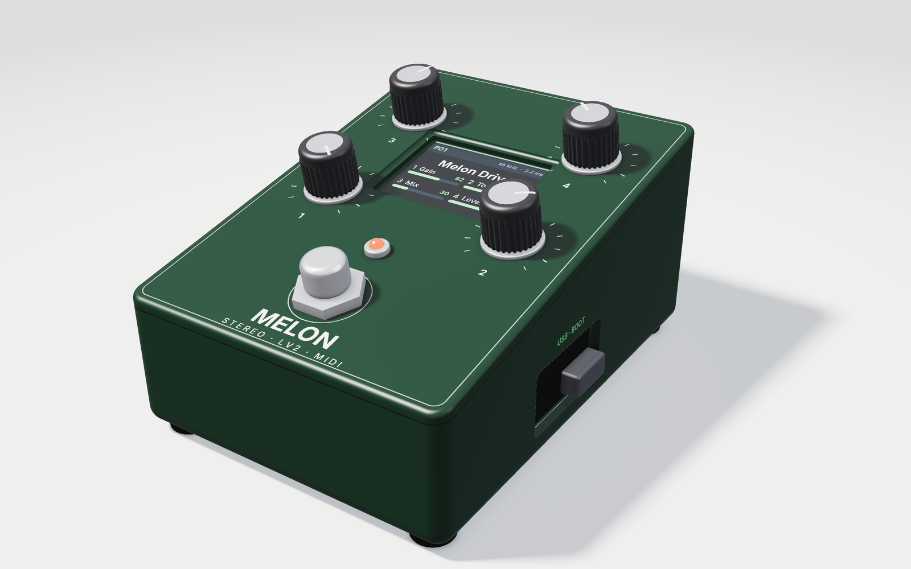

# Enclosures

One sub-folder per design variant. Each folder is self-contained: STL files, the generator script, preview images and notes.

| Variant | Audio I/O | Shape | Status |
|---|---|---|---|
| [`hifiberry-wedge/`](hifiberry-wedge/README.md) | HiFiBerry DAC2 ADC Pro HAT on the Pi, Hi-Z/low-Z buffers on the I/O board | Wedge, 40 mm front → 65 mm back, tray + sloped lid | v0.2, ready for a fit-check print |
| `usb-audio/` | External USB audio interface | (in progress) | in progress |

Shared parts of the project (the Pi 4, LCD, encoders, footswitch, MIDI, software) are documented in [`docs/`](../../docs/).

