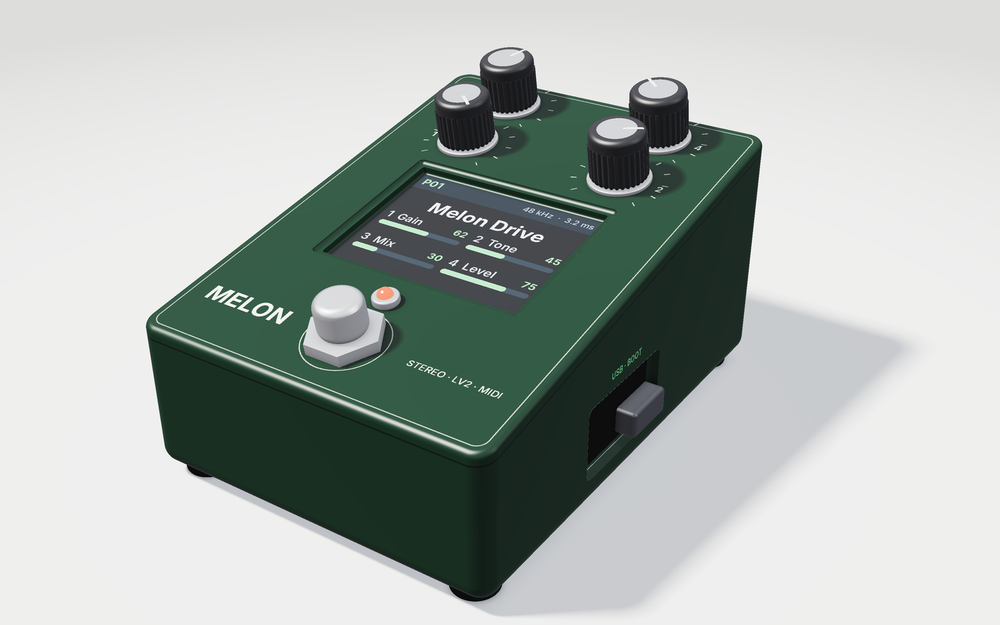
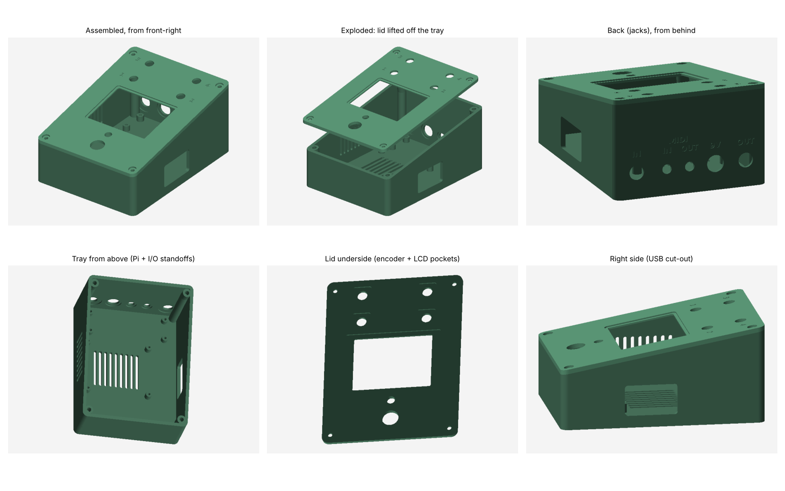
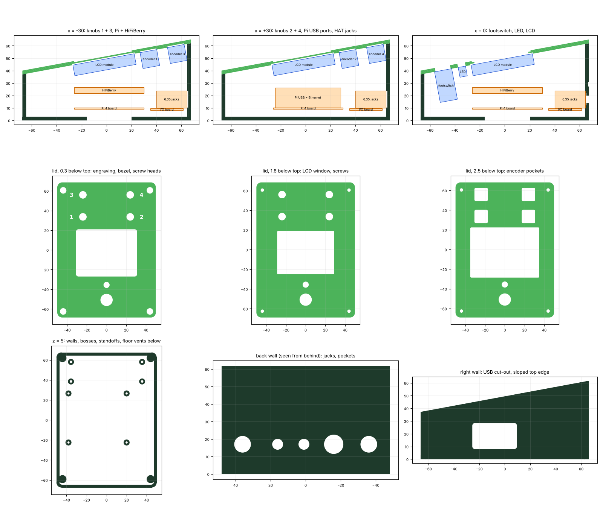

# Enclosure variant: HiFiBerry wedge (v0.3, fit-check print)

**v0.3 (2026-11-24):** new lid layout: **2.8" ILI9341 screen (320×240)** in the middle, the **four knobs in a 2 × 2 grid at the back** (like the PoC), footswitch and LED further forward, knob numbers beside the knobs. Only the lid changed; the tray is the same as v0.2.

Audio goes through the **HiFiBerry DAC2 ADC Pro** HAT on the Pi (see the [hardware architecture](../../../docs/hardware-architecture.md)). Everything for this variant lives in this folder: STLs, generator, previews and concept renders.



A wedge in the style of the BOSS 200 series: **40 mm high at the front, 65 mm at the back** (100 × 135 mm footprint). The top slopes about 10.5° toward the player, which puts the footswitch lower and tilts the LCD toward you. The back stays 65 mm, so the jacks and the inside layout are the same as in v0.1.

Two printed parts, generated by [`make_enclosure.py`](make_enclosure.py) in this folder:

| File | Part | Print orientation |
|---|---|---|
| `melon-pedal-tray.stl` | Floor + four walls. Pi 4 and I/O board standoffs on the floor, jacks in the back wall, USB cut-out in the right wall | **Upright**, floor on the bed. No supports |
| `melon-pedal-lid.stl` | Sloped top, 3 mm. Encoders, LCD, footswitch and LED mount here | **Upside down**, top face on the bed. No supports |



This version uses typical datasheet sizes, because the parts haven't arrived yet. **Measure your real parts and update the parameters before the final print** (checklist below). Treat the first print as a fit check.

## Regenerate

```
python3 hardware/enclosure/hifiberry-wedge/make_enclosure.py             # STLs into this folder
python3 hardware/enclosure/hifiberry-wedge/make_enclosure.py --preview   # + preview images and a clearance report
python3 hardware/enclosure/hifiberry-wedge/render_concept.py              # concept renders (~1.5 min per view)
```
Needs `numpy`, `scipy` and `matplotlib`. All dimensions are in the PARAMETERS block at the top of the script (`H_FRONT` and `H_BACK` set the wedge).

The script prints a **clearance report**: for every part hanging under the lid (encoders, LCD, footswitch, LED), the vertical gap to the part below it (Pi, HiFiBerry, jacks). The part sizes are estimates in `FLOOR_PARTS` and `LID_PARTS`. Update them when you have the real parts.

Labels use the brand font **Fredoka** when it is in `tools/fonts/` or `E:\melon_plugins\branding\fonts\`. Otherwise they fall back to DejaVu Sans Bold.

## Print settings (suggested)

- **Material:** PETG or ASA (PLA softens in a hot car or near the Pi).
- **Settings:** 0.2 mm layers, 4 walls (perimeters), 20–25 % infill, 5 top and bottom layers.
- **Tray:** the USB cut-out's top edge is a 35 mm bridge. Enable bridging (default in most slicers) or add a support enforcer only there if your printer bridges poorly. The four corner bosses lean 10.5°, which prints fine without support.
- **Lid:** printed top-down, so the top face comes out flat and the engraved knob numbers are crisp.
- **Multiple shells:** each STL is several overlapping closed shells. PrusaSlicer, Bambu Studio, OrcaSlicer and Cura merge them automatically. Import each file as **one object**, and don't use "split to parts".

## Assembly

1. Press four **M3 heat-set inserts** into the tray's corner bosses (hole Ø 4.0 mm, 9 mm deep, square to the lid). Use the soldering iron at about 220 °C for PETG.
2. Tray: jacks in the back wall (nuts outside; the wall is thinned to 2 mm around them). Screw the Pi 4 to its standoffs with **M2.5 × 6** screws (they self-tap into the 2.2 mm pilot holes), and screw the I/O board on.
3. Lid: footswitch, LED bezel and encoders (nuts on top; the lid is 2 mm thick at the encoders). Hold the LCD under its window.
4. Connect the flat cable, put the lid on and fix it with four **M3 × 8 button-head** screws. The heads sit flush in counterbores.

## Clearance (v0.2 estimates)

| Part under the lid | Gap to the part below |
|---|---|
| Encoders 1, 2 | 15 mm above the HiFiBerry |
| Encoders 3, 4 | 22 mm above the 6.35 mm jacks |
| **2.8" LCD board** | **2 mm above the HiFiBerry's RCA/3.5 mm jacks** *if* they sit at the board's USB end (to verify) |
| Footswitch | 11 mm above the floor |
| LED | 32 mm above the floor |

The only tight spot is the screen board over the HiFiBerry's own output jacks. Your audio goes through the header connectors, so those jacks are unused. If the HiFiBerry, once it arrives, really has them there, either:
- remove the RCA/3.5 mm jacks (already in the optimization backlog), which gives ~13 mm, or
- check the real gap with both boards in hand; wire the screen with a right-angle header or wires, never straight pins pointing down.

## Measure before the final print

| Part | Parameter | Value in v0.2 |
|---|---|---|
| 6.35 mm TRS jack thread | `JACKS[0]`, `JACKS[4]` hole | 9.5 mm |
| DC jack (DC-022B) thread | `JACKS[1]` hole | 11.0 mm |
| 3.5 mm MIDI jacks (PJ-392) thread | `JACKS[2]`, `JACKS[3]` hole | 6.2 mm |
| EC11 bushing / body | `ENC_HOLE`, `ENC_POCKET` | 7.6 mm / 13.6 mm square. EC11 has a small anti-rotation tab: bend it off or add a hole |
| Footswitch thread / body depth | `FOOT_HOLE`, `LID_PARTS["footswitch"]` | 12.4 mm / 25 mm |
| LED bezel | `LED_HOLE` | 6.2 mm |
| 2.8" LCD glass outline / board size | `LCD_POCKET`, `LID_PARTS["LCD module"]` | 70 × 51 mm / 86 × 50 × 8.7 mm |
| 2.8" LCD active area position on the glass | `LCD_VIEW`, `LCD_C` | 58 × 44 mm, centred (many boards are off-centre: measure) |
| Heat-set insert | `INSERT_HOLE` | 4.0 mm |
| HiFiBerry jack position and height | `FLOOR_PARTS[...]` | at the USB end, 11 mm tall |
| Pi USB stack height, Pi position | `USB_CUT_Z`, `PI_X0`, `PI_Y0` | ports end 1 mm inside the right wall |



## Not in v0.2 yet

- Engraved "melon" wordmark on the lid (waiting for the Fredoka font).
- Mounting posts for the LCD module (needs the module's hole pattern). For the fit check, hold it with double-sided foam tape.
- 30 mm fan mount and an aluminium bottom plate.
