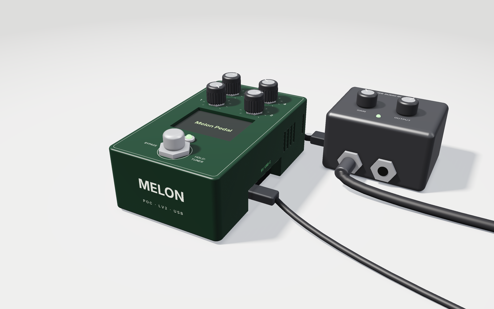

# Melon Pedal — PoC enclosure (USB audio interface)

3D-printable box for the proof of concept: Raspberry Pi 4 + external USB audio interface, LCD, 4 encoders,
footswitch and LED in the top. Spec: project doc `04-poc-usb-interface.md`.

Concept renders: [hero](render-poc-hero.png) · [back](render-poc-back.png) · [top](render-poc-top.png) (`render_poc.py`, numpy + Pillow; the LCD shows `software/melon-display/preview/chain.png`; the USB interface is a generic stand-in). STL check: [preview](preview-poc.png).

| File | What |
|---|---|
| `melon-poc-shell.stl` | Top panel + 4 walls. **Print upside down** (top on the bed): every wall cut-out is open at the bottom, so no supports are needed |
| `melon-poc-plate.stl` | Bottom plate with the Pi 4 standoffs and vents. Print flat |
| `render_poc.py` | Concept renders (ray marcher, ~5 min per view at 1600 × 1000) |
| `make_poc_enclosure.py` | Generator: every size is a parameter at the top. `python3 make_poc_enclosure.py --preview` (numpy, scipy, matplotlib) |

**Outside:** 72 W × 120 D × 40 H mm (plate included). Inside 67.2 × 115.2 × 34.6 mm. Walls and top 2.4 mm, plate 3 mm.

**2026-11-24:** widened from 65 to 68 mm: the 2.0" LCD board (GMT020-02-7P, ~61.5 mm wide) did not fit the 60.2 mm inside width of the first print. The LCD pocket is now 61.5 mm wide, the front screw columns moved out with the walls, and the Pi moved 1.5 mm right so its USB-C/HDMI ports keep their place at the right-wall cut-out.

**2026-11-24 (second print):** widened to 72 mm and the fixing redone after the first print showed the hanging rear pillars were fragile. The plate now fixes at all four extremities (two front corner columns, two rear bosses fused to the side walls beside the Pi), the Pi is screwed to the plate on its own with all four holes, and the LCD module gets four screw bosses. The Pi is centred (5.6 mm each side), so its USB-C/HDMI ports now sit 5.6 mm in from the right wall; the cut-out was made 1.5 mm taller for the plugs.

## Layout
- **Top, front to back:** footswitch Ø12.2 (reinforcing ring underneath) · LED bezel Ø6.0 · 2.0" LCD window
  42 × 32 with a 1 mm locating pocket underneath for the module (61.5 × 35.5) and 4 × M2 screw bosses · 4 × EC11 Ø7.2 in a
  2 × 2 grid (28 mm across, 20 mm front to back; knobs 1–2 front row, 3–4 back row).
- **Pi 4:** 85 mm side along the depth, USB/Ethernet at the back, USB-C/micro-HDMI on the right, GPIO header
  along the left wall, centred across the width. Board on 3 mm standoffs on the plate.
- **Back wall:** open cut-out for the 4 USB ports + Ethernet (audio interface and boot drive plug in here).
- **Right wall:** open cut-out for USB-C power + both micro-HDMI; vents in the rear half.
- **Fixing points:** M3 insert columns in the two front corners; M2.5 bosses fused to the left and right walls at the rear (10 mm long, 5 mm deep). Nothing hangs free from the top.
- **Left wall and plate:** vents (wall slots have 45° pointed ends, so they print without supports or bridges) (plate slots under the SoC). No room for a fan: use a heatsink and check
  `vcgencmd measure_temp` under a full chain.

## Assembly
1. Melt **2 × M3 heat-set inserts** (M3 × 5.7, Ø4.0 hole) into the two front corner columns, from below.
2. Pi onto the plate: **4 × M2.5 × 6** from above through the Pi's four holes into the standoffs (blind holes,
   self-tapping). The Pi and plate are now one unit.
3. LCD into the top: glass into the pocket, then **4 × M2 × 4** through the module's corner holes into the bosses.
4. Mount the footswitch, LED and encoders in the top and wire everything to the GPIO header.
5. Lower the shell over the Pi (the cut-outs are open at the bottom, so the ports slide in).
6. From below: **2 × M3 × 8** into the front inserts (counterbored) and **2 × M2.5 × 12** pan head into the rear
   wall bosses (self-tapping; no counterbore there, the head sits on the plate edge and the wall).

## Print
PETG or ASA (PLA softens near a warm Pi). 0.2 mm layers, 4+ walls, 5 top/bottom layers, 30–40 % infill.
Each part is several overlapping closed shells; PrusaSlicer, OrcaSlicer, Bambu Studio and Cura merge them
(Cura: *Union overlapping volumes* on, the default).

## Measure before printing
- **LCD module:** board size (pocket 61.5 × 35.5) and where the visible area sits on it (window centred by default).
  **Hole positions are a guess** (`LCD_HOLES`: 2.5 mm in from each board corner, i.e. 56.5 × 30.5 centre to centre)
  and so is the glass + backlight height above the PCB (`LCD_STACK` = 2.7 mm). Measure both.
- **LED bezel** hole (6.0) and **footswitch** thread (12.2).
- **Rear encoders:** their pins end about 2 mm above the Pi's USB ports. Trim or bend them and add Kapton tape.
- **EC11 anti-rotation tab:** snap it off (no slot is printed).
- **Inserts:** some kits want a 4.2 mm hole (`INSERT_HOLE`).

Change a value in `make_poc_enclosure.py` and run it again to regenerate the STLs.
