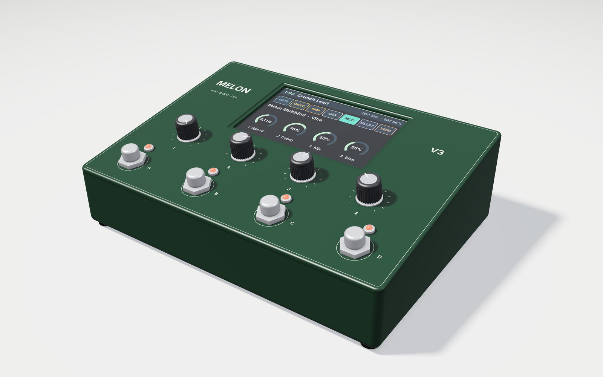
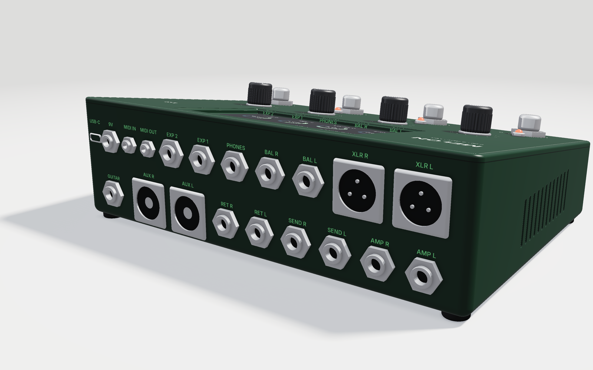
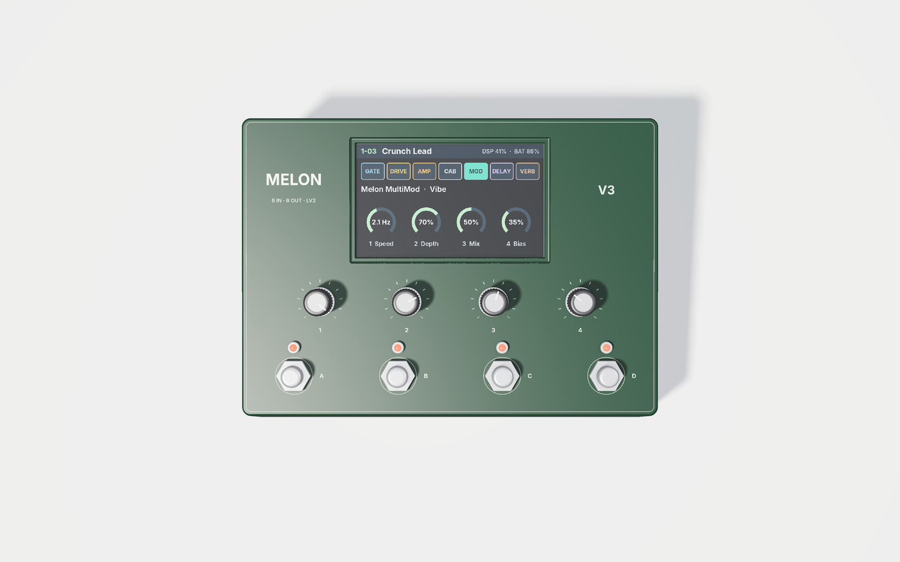

# V3 floor unit: concept renders (2026-11-24)

First look at the planned V3 (see [product versions](../../../docs/product-versions.md)): 5" 800×480 screen, four knobs, four footswitches (A–D) with LEDs, 6 in / 8 out audio board, battery. About 240 × 170 mm, 45 → 70 mm high. **Concept only:** no enclosure generator or STLs yet, and every size is an estimate.

Back panel, two rows (seen from behind, so the player's left is on the right):
- **Top row:** USB-C (charging), 9 V DC, MIDI IN, MIDI OUT, EXP 2, EXP 1, PHONES, BAL R, BAL L (balanced 6.35 mm TRS), XLR R, XLR L (male XLR, balanced, same drivers as BAL).
- **Bottom row:** GUITAR (Hi-Z), AUX R, AUX L (XLR/TRS combo inputs), RET R, RET L, SEND R, SEND L (FX loop), AMP R, AMP L.

Regenerate: `python3 render_v3.py` (numpy + Pillow; ~4 min per view at 1600 × 1000, `--only hero|back|top`). Adapted from the V2 renderer in `../hifiberry-wedge/render_concept.py`.
